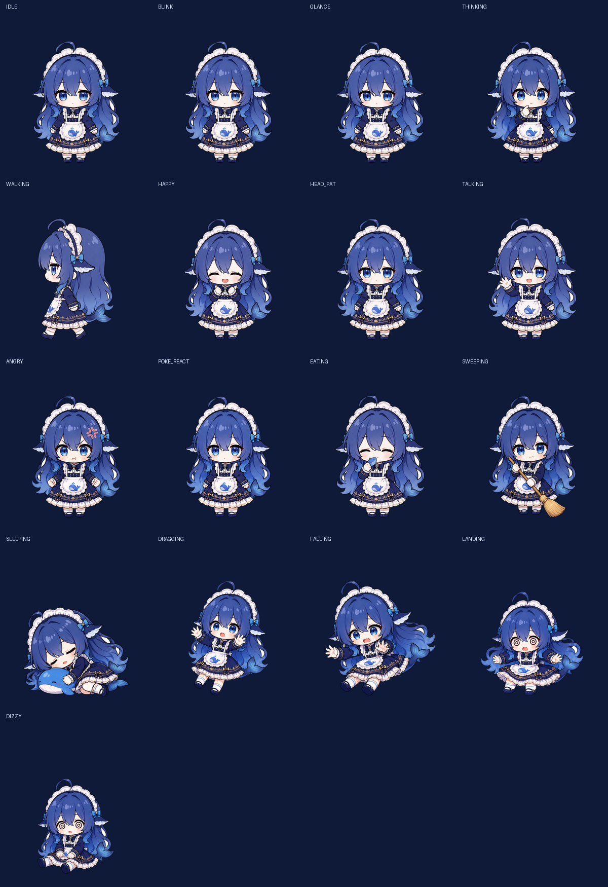
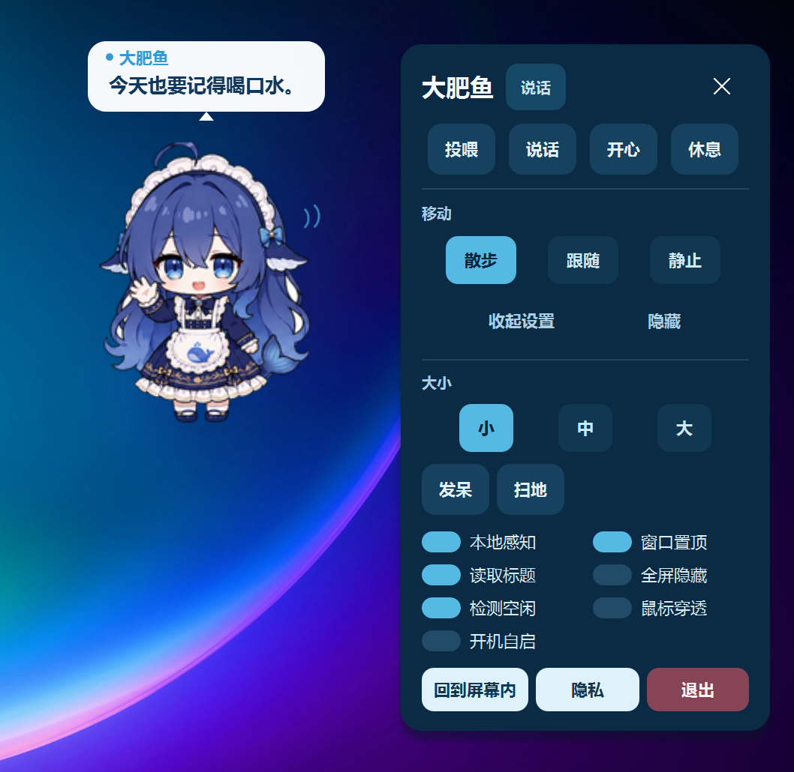

# 大肥鱼桌宠 🐋

一个 Windows 优先、本地优先的轻量桌面宠物。大肥鱼会在桌面散步、回应不同部位的鼠标互动，并可在完全本地的前提下感知当前应用场景。

[](https://github.com/QCYTSN/ds-local-pet/actions/workflows/test.yml)


<p align="center">
  
</p>

<p align="center">
  
</p>

## 下载

Windows 用户可以直接从 GitHub Releases 下载，无需安装 Python、无需管理员权限。

[**Latest Release →**](https://github.com/QCYTSN/ds-local-pet/releases)

- 推荐：下载 `DS-Local-Pet-Setup-v0.2.0.exe`，安装后从开始菜单或桌面快捷方式直接启动。
- 便携使用：下载 `.zip`，解压后双击 `DS-Local-Pet-v0.2.0-win-x64.exe`。

## 核心特点

- **左右独立四帧行走**与动作分段 — 起步、循环、收步分开播放，右走不是左走的简单镜像
- **分层生命节奏** — 眨眼、左右观察等微动作与散步、扫地、休息等完整活动分别调度，安静但不僵硬
- **分区互动反馈** — 脸、头、身体和尾巴分别命中；长按摸头、连续戳、连续投喂和快慢拖拽都有不同反应
- **鼠标互动与抛掷物理** — 摸头、戳身体、半空抓取、重力下落、边界反弹、落地与重摔眩晕
- **窗口顶部落脚** — 可把大肥鱼放到普通窗口顶部，她会随窗口移动并在可用范围内继续散步
- **本地环境感知** — 可选感知前台窗口类型（编码、文档、视频等），仅读取本地元数据
- **470 条本地语料** — 四种人格语气，覆盖关系阶段、日常场景、恢复启动、落地、重复互动与社区梗
- **崩溃恢复** — 状态定时原子保存、配置备份、轮转日志；连续异常时自动进入低动态安全模式
- **完整 Windows 发布体验** — 中文安装程序、稳定快捷方式、卸载保留状态、GitHub Releases 自动更新与 SHA-256 校验
- **轻量常驻设计** — 动作、台词和感知逻辑均在本地运行，不加载模型、不截图、不上传桌面信息

## 界面展示

| 气泡与互动反馈 | 右键快速控制 |
| --- | --- |
|  |  |

## 快速使用

| 操作 | 效果 |
| --- | --- |
| 单击脸/头部 | 不同的亲近反馈与台词 |
| 长按脸/头部 | 连续摸头动作 |
| 单击身体 | 被戳反馈；短时间连续戳会明确生气 |
| 单击尾巴 | 回头、甩尾与专属台词 |
| 双击角色 | 打开投喂面板 |
| 按住并拖动 | 进入抓取状态；松手后按真实速度下落，重摔才会眩晕 |
| 拖到普通窗口上方松手 | 开启“窗口落脚”时，会落在窗口顶部并跟随窗口移动 |
| 右键角色 | 打开紧凑快速控制面板 |
| 点击托盘图标 | 显示或隐藏桌宠 |
| 托盘“检查更新” | 手动检查、下载或安装新版本 |

右键面板默认只显示投喂、说话、开心、休息和移动模式；“更多设置”中提供尺寸、陪伴节奏、走路速度、减少动态、悬停暂停、窗口落脚、本地感知、置顶、全屏隐藏、鼠标穿透、开机自启和隐私入口。

## 隐私说明

启用本地感知后，程序可读取以下低频元数据：

- 前台进程名
- 窗口标题（可关闭）
- 用户空闲时长（可关闭）
- 是否全屏
- 前台窗口外框位置（仅在“窗口落脚”开启时用于碰撞与随动）

**不会截图、读取窗口正文、读取网页正文、读取浏览历史、上传窗口标题或持久化感知记录。** 窗口落脚只使用句柄和外框坐标。密码管理器、支付/银行、远程桌面、聊天、邮件和无痕窗口默认不会触发台词；可在 `config.json` 的 `privacy.custom_process_names` 继续补充本地屏蔽名单。

安装版默认每天至多向 `api.github.com` 发起一次版本检查，只携带应用名称和当前版本；发现新版本后仅从本仓库 GitHub Release 下载安装包，校验 GitHub 提供的 SHA-256 摘要后才会询问安装。此请求不包含窗口标题、进程名或任何桌面感知数据；可在配置的 `updates.enabled` 中关闭。

## 恢复、安装与更新

- 安装版的设置、关系状态、日志和更新缓存位于 `%LOCALAPPDATA%\DaFeiYuDesktopPet`，升级或卸载程序不会删除它们。
- 运行中每 30 秒以及正常退出时保存位置与生命状态；主文件损坏时会尝试读取 `.bak` 备份。
- 意外退出后再次启动会恢复上次状态；连续两次异常退出后，本次启动自动关闭环境感知和窗口落脚，并启用减少动态，避免崩溃循环覆盖原设置。
- 日志采用 1 MB × 4 个文件的轮转上限；未处理异常另写入 `logs\crashes`，便于定位问题。
- 自动更新下载完成后由用户确认安装；安装器关闭当前版本、替换固定的 `DaFeiYuDesktopPet.exe`，再通过 Windows Restart Manager 重启。

更完整的技术说明见 [恢复与更新设计](docs/RECOVERY_AND_UPDATES.md)。

## 从源码运行

适用于 Python 开发者：

```powershell
git clone https://github.com/QCYTSN/ds-local-pet.git
cd ds-local-pet
py -3.11 -m venv .venv
.\.venv\Scripts\python.exe -m pip install -r requirements.txt
```

安装完成后，双击 `启动大肥鱼桌宠.cmd` 即可。它使用 `pythonw` 在后台启动，不会弹出终端窗口；重复启动会唤回已运行的同一只桌宠。

也可以从终端运行：

```powershell
.\.venv\Scripts\python.exe main.py
```

或查看版本：

```powershell
.\.venv\Scripts\python.exe main.py --version
```

## 技术实现

- **Desktop**：Python + PySide6 透明无边框窗口，系统托盘与 Windows 单实例
- **Animation**：manifest 驱动的 enter/body/exit 动作协议 + PNG 帧动画，含独立微动作层、优先级中断与无重影切换
- **Behavior**：微动作与完整活动分层调度；根据体力、无聊度、情绪、上下文、活动强度和近期记忆决策
- **Interaction**：区域命中检测 + 限速抛掷、重力、屏幕/窗口表面碰撞、反弹、摩擦与落地判定
- **Awareness**：Windows 前台窗口元数据，本地分类与隐私过滤
- **Storage**：本地 JSON 原子写入、备份恢复、会话心跳、轮转日志与安全模式
- **Delivery**：PyInstaller onedir + Inno Setup 当前用户安装 + GitHub Releases 校验更新
- **Privacy**：默认不截图、不录音、不上传桌面信息

深入内容见 [docs/](docs/)。

## 项目结构

```text
app/          启动、单实例、路径、崩溃恢复与自动更新
animation/    manifest、状态机、帧播放器、过渡与绘制效果
pet/          窗口、渲染、移动、互动与生命状态
awareness/    前台窗口、空闲、全屏和隐私过滤
behavior/     活动导演、需求评分、分类、事件去抖与回应决策
dialogue/     本地台词与人格调度
assets/       运行时图集、动作 manifest、台词和预览
settings/     紧凑控制面板与 JSON 配置
tests/        单元测试和离屏界面回归测试
tools/        素材校验、处理、预览与性能工具
installer/    Inno Setup 安装定义与中文界面覆盖
```

## 开发与测试

```powershell
.\.venv\Scripts\python.exe -m pytest -q
.\.venv\Scripts\python.exe tools\validate_assets.py
.\.venv\Scripts\python.exe tools\measure_performance.py
.\.venv\Scripts\python.exe tools\simulate_activity.py --minutes 60
```

当前 58 项测试覆盖微动作与完整活动分层、睡眠/醒来、防重复、一小时安静节奏模拟、分类、隐私、配置与备份、生命状态、动作分段、左右独立四帧走路、身体分区、贴地移动、窗口顶部平台、抛掷碰撞、轻/重落地、拖拽裁切、气泡、控制面板、崩溃安全模式和更新包校验。性能报告见 [docs/PERFORMANCE_REPORT.md](docs/PERFORMANCE_REPORT.md)。

构建便携包与安装程序：

```powershell
.\.venv\Scripts\python.exe tools\build_release.py
.\.venv\Scripts\python.exe tools\build_installer.py --skip-bundle
```

## Roadmap

- [x] 多状态角色动画（18 个运行时动作）
- [x] 眨眼、观察、摸头、被戳多帧动画
- [x] 四帧侧向行走
- [x] 起步/循环/收步动作协议
- [x] 鼠标互动、真实抛掷物理与轻/重落地反馈
- [x] 本地环境感知与隐私过滤
- [x] 状态驱动的自主行为与连续活动调度
- [x] 微动作/完整活动/说话分层节奏与三档活动强度
- [x] 体力消耗、短时休息与自然睡醒闭环
- [x] 窗口顶部落脚、窗口随动与表面内行走
- [x] 身体分区、长按与重复互动反馈
- [x] 470 条情境、关系与人格语料
- [x] 崩溃恢复、状态备份、诊断日志与安全模式
- [x] Windows 安装程序、稳定快捷方式与自动更新
- [ ] 更多高频动作的连续帧与稀有小事件
- [ ] 可选本地 Agent 事件桥接

当前项目刻意不加入账号体系、云端 Dashboard、遥测或常驻模型。它的“完整”指桌宠本体、恢复、安装和更新闭环完整，而不是把个人桌宠扩张成商业产品。

## 素材与授权

- 项目代码采用 **MIT License**（见 [LICENSE](LICENSE)）
- 角色视觉资产**不适用** MIT 代码许可证，来源与授权条件见 [ASSET_LICENSE.md](ASSET_LICENSE.md)
- 原始参考素材（`assets/source/`、`assets/references/` 及付费姿势原图）不随本仓库或发行包分发
- 上游代码来源见 [CREDITS.md](CREDITS.md)

## 致谢

本项目基于 [1190fasheqi/dafeiyu-pet](https://github.com/1190fasheqi/dafeiyu-pet) 的 MIT 许可桌宠底座进行模块化重构和增量开发。

---

*This is an unofficial fan-made project and is not affiliated with or endorsed by DeepSeek.*
